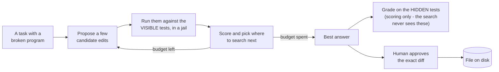
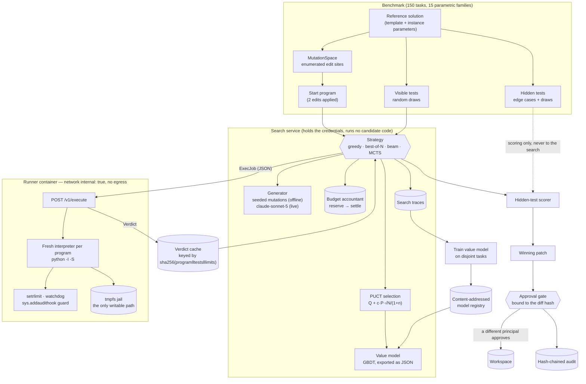

# verifier-guided-search

**A code-fixing agent that does not trust its own first answer: it writes several candidate fixes,
runs each one against real tests inside a locked-down sandbox, and spends the rest of its time on the
branches the tests say are getting warmer.**

When a system asks a language model to fix a bug, the usual shape is: ask once, run the tests you
have, ship whatever passes. Two things go wrong, and both cost real money. The first is waste - the
common upgrade is to ask for twenty answers instead of one and keep the best, which spends twenty
times the compute with nineteen attempts learning nothing from each other. The second is worse: the
patch passes the tests it was shown and fails on the case nobody wrote a test for. That is a wrong fix
merged with a green check mark next to it - the kind that surfaces later as a bad invoice, a corrupted
export, or a night of on-call. And in the middle of all of it, the system is executing code that no
human has read yet, on a machine that has your credentials on it.

This repository is a measurement rig for that problem. It builds a benchmark where the right answer
is known, runs four different ways of spending a fixed compute budget against it, and scores every
one of them on tests the search was never allowed to see. Candidate programs execute in a container
with no network route and nothing worth stealing in it. The headline result is not the search
winning: it is **22.2% of tasks where the answer passed every visible test and still failed a hidden
one** - the failure this whole design exists to make visible before a human is asked to approve
anything.

Everything here runs offline on one CPU. The test suite, the demo and the benchmarks need no API key,
no network and no Docker.

## What this does

- **Turns one guess into a guided search.** Instead of sampling twenty independent attempts, it grows
  a tree: propose a few edits, test them, keep going from whichever branch the tests reward. On this
  benchmark that takes the solve rate from 11.1% (sample-and-pick) to 72.2% (tree search) at the same
  budget.
- **Grades every answer on tests it was never shown.** Each task carries two test groups: a visible
  one the search may use, and a hidden one used only for scoring. The gap between them is the number
  that matters, and here it is 22.2% of tasks - answers that looked correct and were not.
- **Runs unreviewed code in a jail, not on your laptop.** Candidates execute in a separate container
  with no route to the internet, a read-only disk except one scratch directory, no credentials, and a
  hard time limit. An 18-attempt break-out suite (try to open a socket, read a secret, write outside
  the jail, fork-bomb the host) is blocked 100%.
- **Compares strategies at an identical budget, enforced rather than promised.** A budget accountant -
  a component that reserves the worst-case cost before each step and settles the real cost after -
  makes "the same amount of compute" a checked property instead of a claim in a paper.
- **Never edits a file on its own say-so.** A winning patch is proposed, hashed, and refused until a
  *different* person approves that exact hash. The refusal is recorded in a tamper-evident log.

## Architecture

The loop, in one picture - this is the whole idea, and the rest of the diagrams are detail:



The whole system, including the parts that exist because the candidates are untrusted code:



### How a request flows

1. **A request names a task.** `POST /v1/search` (or `vgs search <task>`) asks for one task from the
   benchmark by id, with a strategy and a budget. The caller cannot supply its own program or its own
   tests, and its budget is clamped down to the service's ceiling.
2. **The accountant reserves.** Before any work, the worst-case cost of the next step - candidates,
   sandbox seconds, generator tokens, USD - is reserved. If it does not fit, the search stops and says
   so; it does not overshoot and apologise.
3. **The generator proposes.** Offline, a seeded mutation operator returns the top `k` single edits of
   the current program. Live, `claude-sonnet-5` is asked for `k` rewrites, conditioned on which
   visible tests failed. Either way the generator receives no hidden tests, no free text from the
   sandbox, and no tools.
4. **The sandbox executes.** The program and the *visible* tests go over an internal-only network to
   the runner, which forks a fresh `python -I -S` interpreter per program under POSIX resource limits,
   a wall-clock watchdog and an audit-hook guard. It comes back as a `Verdict`. Identical work is
   answered from a content-addressed cache instead.
5. **The parent grades.** The child is sent each case's *arguments* only and reports what the function
   returned; the comparison against expected values happens outside the sandbox. A candidate cannot
   read the answers out of the harness because the answers were never in there with it.
6. **The tree updates.** The verdict is projected to `VisibleFeedback` - hidden group and all free
   text removed - which is all the strategy, the value model and the next prompt ever see. PUCT picks
   where to descend. The settled real cost is charged.
7. **Steps 2-6 repeat** until the budget is spent or a candidate passes every visible test.
8. **Scoring, then a human.** The committed answer is run against the hidden tests once, for the
   scoreboard only. If it is to be applied to a file, the diff is hashed together with the verdicts
   that justify it and refused until a different principal approves that hash. Every executed program,
   verdict, refusal and approval is appended to a hash-chained audit log.

## Results

Two commands produce every number below, and both write their raw output into the repository:

| command | what it measures | raw output |
|---|---|---|
| `uv run python bench/bench_search.py --check --write-docs` | the evaluation: solve rates, false passes, value model, ablations, escape suite | `bench/results/search.json`, rendered into [docs/EXPERIMENTS.md](docs/EXPERIMENTS.md) |
| `uv run python bench/bench_baseline.py --check` | component micro-benchmarks | `bench/results/latest.json` |

The evaluation ran in **147 seconds** of wall clock on Windows-10-10.0.19045-SP0, 6 CPUs, Python
3.12.14, CPU-only: 630 candidate evaluations accounting for 231.8 s of sandbox time. The sandbox time
is larger than the wall clock because 57.2% of those evaluations were answered from the verdict cache
rather than executed again.

Read the setup before the table. The benchmark run is 30 tasks from 15 families. 12 of them are spent
collecting training data for the value model; the remaining **18 tasks are what these numbers report**,
so the value model has never seen a task it is scored on. Confidence intervals are percentile
bootstrap over tasks, 1000 resamples - with 18 tasks, one task is 5.6 percentage points, and the
intervals are wide because of it. Suite hash `da315e45133c8a30`, seed 20260927.

### Hidden-test solve rate against budget

`uv run python bench/bench_search.py --check` · [full table](docs/EXPERIMENTS.md)

The budget is the number of candidate programs a strategy may evaluate. A row is the share of the 18
tasks where the answer it committed to passed **every hidden test** - the tests it never saw.

| strategy | 1 | 2 | 4 | 8 | 16 candidates | 95% CI at 16 |
|---|---:|---:|---:|---:|---:|---|
| greedy | 0.0% | 0.0% | 22.2% | 33.3% | 33.3% | [11.1%, 55.6%] |
| best_of_n | 0.0% | 0.0% | 5.6% | 11.1% | 11.1% | [0.0%, 27.8%] |
| beam | 0.0% | 0.0% | 5.6% | 44.4% | **72.2%** | [50.0%, 88.9%] |
| mcts | 0.0% | 0.0% | 5.6% | 27.8% | **61.1%** | [38.9%, 83.3%] |

In plain counts, at 16 candidates per task: beam search got **13 of 18 tasks fully right**, MCTS 11,
greedy 6, and sample-and-pick 2. The same compute, the same generator, the same sandbox - only the
policy for deciding what to try next differs.

| strategy | candidates to reach a 60% hidden solve rate |
|---|---|
| greedy | not reached at 16 |
| best_of_n | not reached at 16 |
| beam | 16 (crossed between 8 and 16) |
| mcts | 16 (crossed between 8 and 16) |

Two mechanisms explain the losers, and both are asserted as tests rather than argued:

- **best-of-N cannot repair a two-edit bug.** It only ever expands the root, so every candidate it
  evaluates is one edit from the start program, while every task needs two
  ([`test_best_of_n_never_leaves_depth_one`](tests/integration/test_strategies.py)). This is a
  property of searching an *edit space*, not a measurement of best-of-N over whole programs - see
  Non-goals.
- **greedy cannot backtrack.** It commits to the top-ranked edit at each step, so a wrong turn costs
  it the rest of its budget. Doubling its budget from 8 to 16 buys it nothing at all.

### Verifier false-pass rate

**22.2% of tasks - 4 of the 18 - at budget 4 and above, for all four strategies.** The search
satisfied every visible test, and then the hidden tests failed. This is the number the two-group
benchmark exists to produce: it is the rate at which a green test run would have lied to you. Visible
solve rates run 16.7 to 22.2 points above hidden ones at budget 4 and above, and that gap is rendered
from the results file rather than typed
([`render_verifier_gap`](src/verifier_guided_search/experiments/report.py)), because a hand-written
range is exactly the kind of number that drifts away from the table above it.

It does not shrink as the budget grows, and the reason is not that search keeps inventing new wrong
answers. The set of tasks whose visible suite a wrong program can satisfy is fixed and small. Beam,
MCTS and best-of-N are fooled on the *same four tasks* - two instances of `balanced_brackets` and two
of `normalize_spacing`, 2 of the 11 reported families - while finding 16, 14 and 5 visible solves
respectively; greedy is fooled on four as well, three of them the same. And one of those tasks,
`balanced_brackets/01`, starts out already passing every visible test and failing a hidden one, so it
is a false pass for every strategy at every budget with no search at all. The per-strategy task ids
are printed in [docs/EXPERIMENTS.md](docs/EXPERIMENTS.md), so this is checkable rather than asserted.

### Value model, and an honest negative result

| figure | value | what it means |
|---|---|---|
| held-out AUC | **0.952** | given one solving and one non-solving candidate, the model ranks them correctly 95% of the time |
| held-out ECE | 0.081 | its stated probabilities are off by about 8 points on average |
| training data | 57 rows from 8 tasks | held out on 24 rows from 4 further tasks, split by task so two mutants of one reference cannot straddle the split |
| MCTS at budget 16, model **on** | 61.1% | 11 of 18 tasks |
| MCTS at budget 16, model **off** | **66.7%** | 12 of 18 tasks |

The AUC is comfortably past the 0.75 target in the specification, **and the model does not improve the
search.** The on/off ablation is flat at budget 8, and repeating the whole reported sweep with the
model off gives 66.7% against 61.1% with it - one task's difference, well inside the intervals, but
certainly not an improvement. That comparison is a measured row in `bench/results/search.json`
(`sweep_value_model_off`), not an aside.

That negative result is the most interesting thing the ablations found, and the cause is visible in
the scores: the model assigns ~0.0001 to almost every candidate and ~0.9 to a solving one. It ranks
superbly (hence the AUC) but is *saturated*, so it cannot order the unsolved candidates - which is
the only thing PUCT actually needs it for. The coarse-but-graded visible pass fraction (0, ⅓, ⅔, …) is
a better search signal than a sharp-but-collapsed probability. Stated generally: a model selected for
discrimination is not automatically a good search heuristic, because AUC measures separation *between*
classes and a tree search needs resolution *within* the negative one.
[ADR 0004](docs/adr/0004-value-model-does-not-help-search.md) records why the default is nevertheless
left on.

Relatedly, the `c_puct` ablation favours **0.0** (45.5% versus 27.3% at every positive value, 5 tasks
against 3 out of 11, intervals heavily overlapping) - that is, no exploration at all. What that
ablation can and cannot show is worth being precise about, because **only the `0` versus `> 0` contrast
is identifiable here, and that is arithmetic rather than a finding.** The score is
`Q + c·P·√N/(1+n)`: if `Q` is tied across the siblings being compared, the argmax reduces to `P/(1+n)`
and the constant cancels. Ties are the normal case here from both directions - the value model is
saturated, and with it off `Q` is a pass fraction with four or five possible values. The results file
shows the consequence: with the model on, the `c_puct` 0.7 and 1.4 rows carry exactly the same
`mean_sandbox_seconds` and `mean_generator_tokens`, down to the last digit stored - i.e. they ran the
same programs in the same order. The grid is therefore also swept with the value model off
(`c_puct_value_model_off`), where the three positive values do spend differently - and still land on
the same solve counts. The default is left at the literature value of 1.4 rather than retuned, because
tuning it on the tasks these results are reported on would be selecting on the test set.

### Sandbox escape suite

`uv run vgs escape-suite` (also part of `tasks.py demo` and `tasks.py bench`)

**100% of 18 attempts blocked.** Each attempt is a program whose single test passes *only if the
escape succeeded*, so "blocked" means "no attempt returned its success marker", not merely "nothing
crashed". The attempts: socket connect, DNS lookup, HTTP fetch, subprocess spawn, `ctypes` load,
writes and reads and `listdir` and `chdir` outside the jail, renaming and hard-linking a file out of
the jail, taking an `os.open` write handle on a standard-library file, `/proc` probing, environment
secret reads, a fork bomb, two thread bombs and a long sleep. 14 were refused by the in-process audit
guard; the rest by the environment allowlist or the wall-clock watchdog.

Four of the 18 are there because an adversarial review escaped that way, and they now pin the fixes.
The guard checked only the *first* path argument of an audit event, so the destination of `os.rename`,
`os.replace` and `os.link` was never checked and a candidate could move or hard-link a file from its
jail to any absolute path; and it decided "is this a write?" from the mode string alone, which
`os.open` does not supply, so an `os.open` with write flags fell through to the lenient *read* check -
which accepts the standard library. (That attempt writes no bytes: it opens an existing
standard-library file for writing and closes it, because holding the descriptor is already the
containment failure and the suite has to be safe to run on a developer's own interpreter.) The fourth
is `thread_bomb_via_subclasses`, which is **not** refused by the guard: the import deny-list removes
names from `sys.modules` and cannot remove the live `Thread` class that `object.__subclasses__()`
still reaches. It is in the suite to pin which control does stop it - the wall-clock watchdog, and
`pids_limit` in the container.

### Micro-benchmarks

`uv run python bench/bench_baseline.py --check`, same machine · `bench/results/latest.json`

p50 is the typical call; p95 means 19 of 20 calls finished at or under that time. All figures are
microseconds - 1000 µs is one millisecond.

| benchmark | runs | p50 (µs) | p95 (µs) |
|---|---:|---:|---:|
| rate_limiter_check | 20000 | 1.8 | 1.9 |
| llm_request_sha256_10_messages | 2000 | 99.1 | 131.1 |
| verdict_cache_hit | 5000 | 131.1 | 164.1 |
| redact_text_1kb | 2000 | 339.8 | 430.3 |
| mutation_render_3_sites | 500 | 491.5 | 655.3 |
| mutation_space_build | 200 | 716.2 | 987.8 |
| audit_append_fsync | 200 | 7739.6 | 9010.7 |
| audit_verify_1000_entries | 10 | 34907.9 | 37698.7 |

Two of these are worth reading. A verdict cache hit answers in 131 µs at the median, against an
accounted 231.8 s of sandbox time over the evaluation's 630 evaluations - about 0.37 s each, because
every execution is a fresh interpreter - which is why the cache is worth having at all. (The hit is not
free: the key is `sha256(program ‖ tests ‖ limits)` and the test suite is re-hashed per lookup.
Memoising that is an obvious optimisation and is not done, because 131 µs is not where the time goes.)
The cache is a wall-clock optimisation only - the budget charges a candidate whether or not the cache
answers, so it cannot buy extra evaluations. And `audit_append_fsync` at 7.7 ms is the cost of an
`fsync` per audit entry: slow on purpose, because an audit record that is still in a page cache when
the machine dies is not an audit record.

## How it works

| component | file | job |
|---|---|---|
| Benchmark | `tasks/` | 15 parametric families; each instance is a different function with a reference solution, a visible test group and a hidden one |
| Edit space | `mutate.py` | enumerates every edit site in a reference solution (literal shifts, operator swaps, argument transpositions, slice boundaries, dropped branches); a program is a subset of applied sites |
| Strategies | `search/strategies.py` | greedy, best-of-N, beam and MCTS, all generators that yield one evaluation at a time |
| Selection | `search/puct.py` | the AlphaZero PUCT rule, `Q + c_puct · P · √N_parent / (1 + N_child)` |
| Generator | `search/generator.py` | seeded mutation proposals offline; `claude-sonnet-5` through a provider protocol live |
| Budget accountant | `search/budget.py` | reserves the worst case, settles the actual, refuses what does not fit |
| Sandbox | `sandbox/` | runner service, fresh-interpreter child harness, content-addressed verdict cache |
| Value model | `value/` | gradient-boosted classifier over visible feedback and tree position, exported to JSON |
| Approval and audit | `patch.py`, `agentic/audit.py` | diff-hash-bound approval gate, hash-chained log |

Three design decisions carry most of the weight.

**The visible/hidden split is enforced by types, not discipline.** A sandbox run produces a
`Verdict`, which holds both test groups. Everything downstream of the search - the generator, the
value-model features, the node scores - takes a `VisibleFeedback`, which is a projection with the
hidden group and all free text removed. "The search cannot see the hidden tests" is therefore a
property of the signatures ([`sandbox/protocol.py`](src/verifier_guided_search/sandbox/protocol.py)),
and [a property test](tests/unit/test_value_features.py) confirms that permuting every hidden result
leaves the feature vector byte-identical.

That covers the search. The *candidate* is a second reader, and types cannot help there: the harness
and the candidate share one interpreter, so a program can walk `sys._getframe` into the harness's
locals and read whatever the harness was given. A review found exactly that - a candidate that
harvested the job's expected values and returned them from a dict passed every hidden test with no
algorithm at all, and no guard bypass was needed. So the expectations no longer enter the sandbox:
the child is sent each case's *arguments*, reports what the entry point returned, and the parent
compares outputs with expectations
([`grade_group`](src/verifier_guided_search/sandbox/protocol.py),
[regression test](tests/integration/test_sandbox_local.py)). The child holds nothing worth stealing,
which also takes most of the value out of forging a verdict.

**A smaller budget is a prefix of a larger one.** Every strategy is a generator that yields one
evaluation at a time and never inspects the remaining budget, so a run capped at `B` candidates
produces exactly the first `B` evaluations of a longer run. The sweep therefore runs each
(task, strategy) pair once at the top level and reads the five levels off as prefixes: five times
less compute, and every level compared on identical work.
[`tests/integration/test_budget_prefix.py`](tests/integration/test_budget_prefix.py) re-runs the
search with a real smaller accountant and asserts the evaluations match, for all four strategies.

**The model artifact is JSON, not a pickle.** This repo executes untrusted programs for a living; a
pickled estimator is exactly the file an attacker would like it to deserialise. Training uses
scikit-learn, then the fitted ensemble is exported to flat arrays and scored by ~20 lines of numpy.
[A test asserts the export matches `GradientBoostingClassifier.predict_proba` to 1e-9](tests/unit/test_value_model.py),
which is what makes the export trustworthy rather than merely pickle-free
([ADR 0002](docs/adr/0002-json-exported-value-model.md)).

**The central trade-off is exploitation against exploration, and the value model sits on the wrong
side of it.** PUCT's `c_puct` term is what stops the search from committing to the first plausible
branch (greedy's failure) and what stops it from spreading its budget evenly over hopeless ones
(best-of-N's failure). A good value estimate makes exploitation cheap; a saturated one makes it
uninformative, which is exactly what was measured above. The honest reading is that the *structure* of
the search - tree, backtracking, feedback-conditioned expansion - is doing the work here, and the
learned component is not yet earning its place.

**Why this rather than the obvious alternative?** The obvious alternative is best-of-N: sample `N`
independent answers, run the tests, keep the winner. It is simpler, it parallelises perfectly, and it
needs no tree, no value model and no accountant. It is also in the table above, at the same budget,
and it is the worst performer there, because independent samples cannot use the one signal that is
free - *which test failed, and how*. The price of the tree is the machinery this repo is mostly made
of; the honest scope of the win is in Non-goals.

Further reading: [ADR 0003](docs/adr/0003-mutation-operator-generator.md) on why the offline generator
is an explicit edit space and what that costs,
[ADR 0005](docs/adr/0005-split-the-runner-from-the-search-service.md) on splitting the runner from the
search service.

## Security

Ordinary web-app hardening is here (API-key auth, rate limits, body-size limits, redacted logs), but
it is not the interesting part. The interesting part is that **this system's whole job is to execute
code that nobody has reviewed.** One rule follows from that, and the design is mostly consequences of
it: *the process that holds the secrets never runs candidate code, and the process that runs candidate
code holds nothing worth stealing and has nowhere to send it.*

In practice that means a candidate program wakes up in a container with no route to the internet or
to any other container, a read-only filesystem apart from one small scratch directory, no API keys in
its environment, a CPU and memory limit, and a stopwatch. It is not told the answers to the tests it
is being graded on. If it tries to leave, an 18-attempt suite says what happens: nothing does, 100% of
the time - and each attempt stays in the suite as a regression test.

The [threat model](docs/THREAT_MODEL.md) is STRIDE per trust boundary, with a residual-risk column
that names what is *not* solved. The controls:

| control | where | evidence |
|---|---|---|
| Candidates run only in the runner container: internal network with no egress, read-only rootfs, tmpfs jail, non-root UID, `cap_drop: ALL`, pids/memory/CPU caps | `docker-compose.yml`, `api/runner.py` | [`test_containers.py`](tests/integration/test_containers.py) |
| No Docker socket mounted anywhere, no privileged service | compose + Dockerfile | [`test_no_service_mounts_the_docker_socket`](tests/integration/test_containers.py) |
| Fresh interpreter per program, `-I -S`, rlimits, wall-clock watchdog, `sys.addaudithook` guard raising a `BaseException` a candidate cannot swallow | `sandbox/child.py` | [escape suite](tests/integration/test_sandbox_escape.py), [harness tests](tests/unit/test_sandbox_child.py) |
| Resource limits are a ceiling the caller can only ask for *less* than | `api/runner.py` | [`test_a_caller_cannot_raise_the_resource_ceiling`](tests/integration/test_api.py) |
| No secrets in the runner: its environment is an allowlist, and the image and compose service hold no API key | `sandbox/local.py`, compose | [`test_the_child_environment_carries_no_secrets`](tests/integration/test_sandbox_local.py) |
| A patch is applied only after a *different* principal approves the exact diff hash; single use, expiring, refused if the file moved on | `patch.py` | [`test_patch.py`](tests/unit/test_patch.py) |
| Token, sandbox-second, candidate and USD budgets that cannot be exceeded | `search/budget.py` | [stateful property test](tests/unit/test_budget_accountant.py) |
| Task statements, programs and test output are untrusted data in prompts; the generator gets no tools | `search/prompting.py` | [`test_prompting.py`](tests/unit/test_prompting.py) |
| No free text from a run reaches a prompt - only test names, statuses and exception class names | `sandbox/protocol.py` | [`test_no_free_text_from_a_run_reaches_the_prompt`](tests/unit/test_prompting.py) |
| Hash-chained audit of every executed program hash, verdict, refusal and approval | `agentic/audit.py` | [`test_every_executed_program_reaches_the_audit_chain`](tests/integration/test_strategies.py) |
| Value models verified against their own content hash before use; `/readyz` refuses an edited artifact | `value/registry.py` | [`test_value_registry.py`](tests/unit/test_value_registry.py) |
| No pickle anywhere; the model ships as JSON | `value/model.py` | [`test_no_pickle.py`](tests/unit/test_no_pickle.py) |
| API-key auth (digests only), rate limiting, body-size limits, PII redaction, non-leaking errors | `core/` | [`test_app.py`](tests/integration/test_app.py) |
| Neither blocking route runs on the event loop, and each bounds its own concurrency, so one in-flight search cannot take `/healthz` down with it | `core/concurrency.py`, `api/` | [`test_the_health_probes_answer_while_an_execution_is_in_flight`](tests/integration/test_api.py) |

**The in-process guard is defence in depth, not the boundary.** The harness and the candidate share
one interpreter, so a determined program can interfere with its own bookkeeping. The container is the
boundary. The escape suite measures the guard because a cheap layer that demonstrably refuses the
obvious moves is worth having and worth regression-testing; it is not a claim that the guard is
sufficient.

Every claim in this file maps to a test, bench script or CI job in [CLAIMS.md](CLAIMS.md), and
`scripts/check_baseline.py` fails if any of those references goes stale - and, since a docstring
citing a file is also a claim, if any repo-relative path mentioned in `src/`, `bench/`, `scripts/` or
`docs/` does not resolve.

## Quickstart

No API key, no network, no Docker, no GPU. Python 3.12 and [uv](https://docs.astral.sh/uv/).

```bash
# Keep the environment off a small disk if you need to:
export UV_PROJECT_ENVIRONMENT=~/.venvs/verifier-guided-search
uv sync --frozen

uv run python tasks.py demo        # the whole thing, offline, on one CPU
```

The demo builds a 15-task benchmark (one instance per family), collects search traces, trains and
publishes a value model, runs all four strategies at matched budgets of 1, 2, 4 and 8 candidates, runs
the sandbox escape suite, and proposes applying the winning program to a scratch workspace. What you
will see, in order:

1. `benchmark: 15 tasks in 15 families (suite ...)`, split into trace and held-out tasks.
2. `[1/4]` trace collection, then `N trace rows -> value model <hash> holdout AUC ... ECE ...`.
3. `[2/4]` the budget-matched comparison, printed as the same shape of solve-rate table as Results
   above - smaller numbers, because the demo's configuration is smaller.
4. `[3/4]` the escape-suite table: every attempt, what stopped it, and the blocked share.
5. `[4/4]` the winning patch, its diff hash, and then the line worth watching:
   `refused: approval <id> required, bound to the diff hash`. Nothing is written until a different
   principal approves that hash. `--no-approve` stops there, which is what a real deployment looks
   like.
6. `audit: N entries, head <hash>, chain verified`.

The rest of the entry points:

```bash
uv run python tasks.py test        # the full suite, branch coverage, floor 85%
uv run python tasks.py bench       # the micro-benchmarks and the evaluation above
uv run python tasks.py calibrate   # why the two difficulty dials are where they are
uv run python tasks.py lint typecheck audit baseline

uv run vgs tasks                        # list the benchmark and its content hash
uv run vgs tasks run_length_encode/00   # one task: statement, broken program, test counts
uv run vgs search run_length_encode/00  # one budgeted search; --generator claude for the live one
uv run vgs escape-suite                 # the sandbox escape suite on its own
uv run vgs audit verify var/audit.jsonl
uv run vgs serve                        # the search service
uv run vgs serve-runner                 # the sandbox runner (what the runner container runs)
```

## Non-goals

What this is not, in rough order of how much it constrains what the numbers mean.

- **The offline curves describe search over an edit space, not over a model's output
  distribution.** The offline generator enumerates single-edit neighbours of each reference solution
  and scores them with a noisy revert/introduce signal. Every mutant is syntactically valid, the
  neighbourhood is finite and local, and the reference is always reachable - none of which is true of
  a language model. The live `claude-sonnet-5` generator has no such guarantees.
- **No numbers are reported for the live generator.** It is wired and reachable - `vgs search
  <task> --generator claude`, or `APP_GENERATOR=claude` for the search service - and the whole path
  is tested offline by recording a run and replaying it from a cassette
  ([`test_live_generator.py`](tests/integration/test_live_generator.py)). But no `ANTHROPIC_API_KEY`
  was available here, so nothing in Results comes from it, no cassettes of real model responses are
  committed, and `tasks.py record` is still a stub rather than a recording workflow.
- **best-of-N is measured over that same edit space, which under-represents it.** Here "one sample"
  is one edit from the current program, so best-of-N is confined to depth 1 and structurally cannot
  repair a two-edit bug. Real best-of-N samples whole programs. The result in the table is correct
  for the edit-space framing the spec sets out and should not be read as a general finding.
- **Benchmark difficulty is a dial that was chosen by measurement.** Corruption depth 2 is where the
  strategies separate; at depth 1 best-of-N matches the searches and at depth 3 everything flattens
  at the bottom. Same for the generator's noise level. Both sweeps are a script with a committed
  artifact - `uv run python bench/bench_calibration.py --check`, `bench/results/calibration.json` -
  and the numbers are in [ADR 0003](docs/adr/0003-mutation-operator-generator.md), not in prose.
- **0 of the 18 reported tasks start behaviour-preserving**, so no reported solve rate contains a
  free win. 2 of the 30 tasks in the whole suite do, and both landed in the 12-task trace split -
  worth stating that way round, because "2 of 30" invites discounting 11.1% from every rate, which is
  exactly best-of-N's headline number. The classification is produced by the bench on the reported
  split and printed in [docs/EXPERIMENTS.md](docs/EXPERIMENTS.md)
  ([`tasks/validate.py`](src/verifier_guided_search/tasks/validate.py),
  [`test_suite_quality.py`](tests/integration/test_suite_quality.py)).
- **1 of the 18 reported tasks already fools its own visible suite at depth 0.**
  `balanced_brackets/01` starts passing every visible test and failing a hidden one, so it
  contributes a false pass to every strategy at every budget with no search at all. That is not a
  defect - it is the verifier-overfitting case arriving for free - but it is most of why the
  false-pass rate looks constant, and it is reported rather than left to be inferred.
- **18 tasks is a small sample.** Most gaps between adjacent strategies sit inside their confidence
  intervals. The beam-versus-best-of-N gap does not; the beam-versus-MCTS gap does. The full
  150-task suite exists (`vgs tasks`) but takes far longer than the "minutes on a CPU" this repo
  commits to, so the reported configuration is the small one.
- **The value model does not help the search**, as measured (66.7% without it against 61.1% with it,
  MCTS at budget 16 on the reported split). A calibrated or blended value signal (model probability
  mixed with visible pass fraction), and a value model trained on more than 57 rows, are the obvious
  next steps and are not implemented. [ADR 0004](docs/adr/0004-value-model-does-not-help-search.md)
  says why the default is nevertheless left on.
- **Tokens are pro-rated, not measured per candidate.** A generator call produces `k` candidates, so
  a prefix's token count is estimated by the share of evaluations it contains. The headline compute
  axis is therefore verifier calls; token and sandbox-second spend are reported alongside.
- **Not implemented:** the spec's `EXPERIMENTS.md`-generating script covers the sweep, ablations,
  value model and escape suite, but there is no OpenTelemetry span per expansion (only the HTTP
  spans the baseline provides), and no distributed or parallel search. Executions are serial by
  design on a 2 GB CPU-only host.
- **The container controls are verified by reading the declarations**, not by starting Docker. A
  separate CI job (`.github/workflows/ci.yml#sandbox-escape`) runs the escape suite inside compose on
  a Linux runner.
- **Registry integrity is a content hash, not a signature.** It detects corruption and any edit that
  did not also rename the file; it does not stop someone who can rewrite both the artifact and the
  index.
- **The coverage figure does not cover the child harness.** `sandbox/child.py` is copied out and run
  by a separate interpreter as `python -I -S -B`, and `-S` skips `site`, so coverage's subprocess
  startup hook never runs - instrumenting it would mean handing the sandboxed interpreter its
  environment and its site-packages back, which is the hardening the file exists for. The escape
  suite and the sandbox tests exercise it hard and contribute nothing to the number, so the coverage
  table's figure for that one file (the lowest in the repo) understates it while the repo-wide figure
  slightly overstates the rest. The controls in that file are measured by the escape suite instead,
  which is a behavioural check rather than a line count.

## Licence

MIT. See [LICENSE](LICENSE).
