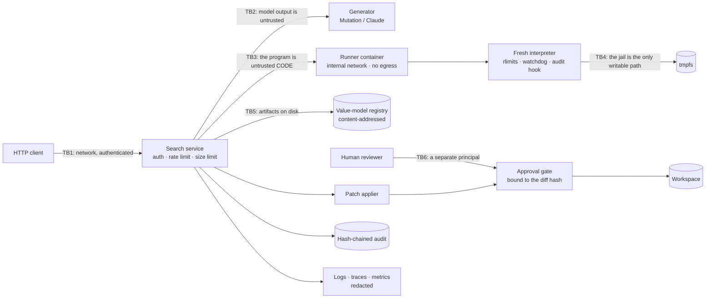

# Threat model

Method: STRIDE per trust boundary. Each row maps a threat to the control that addresses it and to the
test, bench script or CI job that proves the control works. `scripts/check_baseline.py` verifies that
every backticked evidence reference below exists.

## What this system is, and what makes it different

A search service asks a generator for candidate Python programs and runs each one against a
benchmark task's tests. **The candidates are untrusted code that has to be executed** - that is the
whole point of the system, not an incidental feature - so the dominant threat is not "a model says
something bad" but "code we did not write runs on our machine".

Two consequences shape everything below:

1. **The process that holds credentials and the process that executes candidates are different
   processes, on different networks.** The search service has an ingress port, an API key and (live)
   an Anthropic key. The runner has none of those and no route off its network.
2. **The in-process guard is defence in depth; the container is the boundary.** The harness and the
   candidate share one interpreter. A determined program can interfere with its own bookkeeping, so
   no control in `sandbox/child.py` is load-bearing on its own. The escape suite measures the guard
   because a cheap layer that demonstrably refuses the obvious moves is worth regression-testing.

## System and trust boundaries

**Assets**: the host the runner runs on, the API keys and the Anthropic key, the integrity of the
workspace a patch is applied to, the hidden tests (a leak makes every reported number meaningless),
spend, audit evidence, and value-model artifacts.

**Assumptions**: TLS terminates in front of the search service; the container runtime is not itself
compromised; the principals passed to the approval store come from authentication, not from a model;
the benchmark's own generated task sources are ours and are executed once at build time to compute
expected outputs.

**Explicitly out of scope**: a container-runtime escape, a malicious base image, a compromised
scikit-learn or pydantic, and an attacker who can already write to the repository.

## STRIDE table

| ID | STRIDE | Threat | Entry point / asset | Control | Test / evidence | Residual risk |
|---|---|---|---|---|---|---|
| S1 | Spoofing | Caller guesses, replays or brute-forces an API key | TB1, protected routes | Keys stored as SHA-256 digests; constant-time compare against every digest; fail closed with no keys; uniform 401 | `tests/unit/test_security.py::test_every_configured_digest_is_compared_without_early_exit`, `tests/integration/test_app.py::test_protected_endpoint_requires_a_valid_api_key`, `tests/integration/test_api.py::test_the_execute_route_needs_a_key` | No expiry or rotation workflow; per-user identity (JWT, OIDC) is out of scope |
| S2 | Spoofing | A candidate forges a verdict about itself, or replays another program's verdict | TB3, verdict integrity | Each execution carries a fresh nonce; the parent accepts a result only if it echoes that nonce, names the submitted program hash and reports a known status; anything else is `crashed`. The parent also grades the outputs itself, so a forged row has to contain the right answer rather than the word "pass" | `tests/integration/test_sandbox_local.py::test_a_forged_result_file_is_refused_by_the_parent`, `tests/integration/test_sandbox_local.py::test_a_program_cannot_overwrite_its_own_result_file` | Unfixed and pinned by a test: a candidate that reaches the harness's `ResultWriter` in-process can latch a payload of its own, with a valid nonce, because the child legitimately holds one (`tests/integration/test_sandbox_local.py::test_in_process_verdict_forgery_is_a_known_limitation`). It gains nothing unless it already knows the expected outputs, which the child is no longer told; the container bounds the damage |
| S3 | Spoofing | The runner answers about a different program than the one submitted | TB3, verdict integrity | The HTTP client compares the returned `program_sha256` with the request's and refuses a mismatch | `tests/unit/test_sandbox_http_client.py::test_a_verdict_about_another_program_is_refused` | A runner that lies consistently about the *same* hash is not detected; it is inside the trust boundary |
| S4 | Spoofing | The agent approves its own patch, or another principal consumes an approval it did not request | TB6, approval store | Separation of duties: the requester cannot decide its own request, and an approval is consumable only by the principal that requested it | `tests/unit/test_patch.py::test_the_requester_cannot_approve_its_own_patch`, `tests/unit/test_approval.py::test_an_approval_is_bound_to_the_principal_that_requested_it` | Principal strings must come from authentication |
| S5 | Spoofing | Tool or task content forges an envelope claiming a trusted source | TB2, prompt | Reversible escaping of envelope tags; the envelope id is the SHA-256 of source and content | `tests/unit/test_prompting.py::test_an_injected_statement_cannot_break_out_of_its_envelope`, `tests/unit/test_envelope.py::test_a_forged_envelope_inside_content_is_neutralized` | Envelopes help the model; a model can still be persuaded. See E2 |
| T1 | Tampering | A candidate writes outside its jail - into the job file, the harness, or the host | TB4, host | Writes are refused unless the fully resolved path is inside the per-execution tmpfs jail. Every path argument of a two-path event (`os.rename`, `os.replace`, `os.link`, `os.symlink`, the `shutil` pairs) is checked, not just the first, and an `os.open` is classified from its flags as well as its mode string - both were review findings, and both are now escape-suite attempts. The control directory is outside the jail; the container root filesystem is read-only with the jail as the only tmpfs | `tests/integration/test_sandbox_escape.py::test_the_whole_suite_is_blocked`, `tests/unit/test_sandbox_child.py::test_a_strict_check_refuses_a_link_that_leaves_the_root`, `tests/integration/test_containers.py::test_every_service_is_hardened` | The guard shares an interpreter with the candidate; the container is the boundary |
| T2 | Tampering | A poisoned verdict cache silently rewrites every downstream result | Cache file | The key is `sha256(program ‖ tests ‖ limits)`; a persisted line whose stored parts do not re-derive its key is dropped on load, not trusted | `tests/unit/test_sandbox_cache.py::test_a_line_whose_verdict_does_not_rederive_its_key_is_dropped`, `tests/unit/test_sandbox_cache.py::test_the_same_program_against_different_tests_misses` | Someone with write access can write an internally consistent poisoned entry; the cache is local state, not an authority |
| T3 | Tampering | A value-model artifact is edited after publication | TB5, registry | A version *is* the SHA-256 of its card; `load` re-derives it from the bytes read and refuses a mismatch; `/readyz` verifies before the service reports ready | `tests/unit/test_value_registry.py::test_a_tampered_file_fails_its_content_hash_check`, `tests/integration/test_api.py::test_readiness_requires_the_runner_and_a_verifiable_value_model` | A content hash is not a signature: an attacker who can rewrite both artifact and index is not detected |
| T4 | Tampering | A model artifact executes code on load | TB5, registry | No pickle anywhere; the ensemble is exported to flat JSON arrays and scored by numpy, with no scikit-learn import at inference time | `tests/unit/test_no_pickle.py::test_source_tree_has_no_pickle_family_serialization`, `tests/unit/test_value_model.py::test_the_export_matches_scikit_learn_on_held_out_rows`, `.github/workflows/ci.yml#semgrep` | — |
| T5 | Tampering | An approved patch is applied to a file that has since changed, or to a path outside the workspace | TB6, workspace | The diff hash covers the target, the before and after hashes, the diff and the verdicts; the applier re-reads the file and refuses a stale before-hash *before* consulting the gate; every target is a canonical relative path resolved under the workspace root, symlinks included | `tests/unit/test_patch.py::test_a_patch_is_stale_once_the_file_changes`, `tests/unit/test_patch.py::test_a_target_outside_the_workspace_is_refused`, `tests/unit/test_patch.py::test_a_symlink_pointing_out_of_the_workspace_is_refused` | A concurrent writer between the freshness check and the atomic write is a TOCTOU window; the workspace is assumed single-writer |
| T6 | Tampering | Audit entries are edited, deleted, reordered or truncated | Audit log | Hash chain over canonical JSON; a verify CLI; a head anchor for tail truncation; the log refuses to open a broken chain and refuses a file that shrank | `tests/unit/test_audit.py::test_any_single_byte_change_is_detected`, `tests/unit/test_audit.py::test_tail_truncation_needs_an_anchored_head`, `tests/integration/test_strategies.py::test_every_executed_program_reaches_the_audit_chain` | Someone with write access can rebuild the whole chain; publish the head hash elsewhere |
| T7 | Tampering | Reported results cite a benchmark or model that has since changed | Results files | A results file carries the suite hash, the seed, the generator and noise, and the value-model version; the generator refuses a task whose recorded edit-space hash no longer matches | `tests/unit/test_generator.py::test_a_task_whose_space_hash_moved_is_refused`, `tests/unit/test_report.py::test_the_provenance_block_pins_the_seed_the_hashes_and_the_versions` | — |
| R1 | Repudiation | "Which programs did it run, and who approved the change?" cannot be answered | Audit log | Every verdict (program hash, status, visible and hidden counts, violations, cache hit), every search outcome, every patch proposal, refusal and application is appended to the hash-chained log | `tests/integration/test_strategies.py::test_every_executed_program_reaches_the_audit_chain`, `tests/unit/test_patch.py::test_every_decision_reaches_the_audit_chain` | The log records the actor string it is given; binding it to an authenticated identity is the deployment's job |
| I1 | Information disclosure | A candidate reads the hidden tests and passes them trivially | TB4, hidden tests | The expected values never enter the sandbox process: the job carries each case's arguments only, the child reports what the entry point returned, and the parent grades. Filesystem controls are defence in depth on top of that - the job file is in a control directory *outside* the jail and the guard refuses reads outside the jail and the standard library | `tests/integration/test_sandbox_local.py::test_a_frame_walking_program_cannot_read_the_test_expectations`, `tests/integration/test_sandbox_local.py::test_the_job_sent_to_the_child_carries_no_expected_values`, `tests/unit/test_protocol.py::test_an_output_that_matches_its_expectation_passes`, `tests/integration/test_sandbox_escape.py::test_the_whole_suite_is_blocked` | A candidate still learns the *arguments* it is called with, including the hidden ones, which tells it nothing it did not already have. Before this control the filesystem checks were not enough: the child read the job into its own memory, so `sys._getframe` reached the expectations without touching the filesystem |
| I2 | Information disclosure | Hidden test outcomes leak into the search and inflate every reported number | TB3, measurement integrity | A `Verdict` holds both groups; everything the search touches takes a `VisibleFeedback`, which is a projection without the hidden group. Enforced by signatures, not review | `tests/unit/test_value_features.py::test_hidden_results_cannot_reach_the_feature_vector`, `tests/unit/test_value_features.py::test_the_projection_to_visible_feedback_drops_the_hidden_group`, `tests/unit/test_prompting.py::test_the_prompt_never_mentions_the_hidden_tests` | Signatures bind the search process. The sandbox child is the other reader and is covered by I1, which is a protocol control rather than a type one |
| I3 | Information disclosure | A candidate reads credentials out of its environment | TB4, secrets | The child's environment is an allowlist, so no `ANTHROPIC_API_KEY`, key digest or proxy variable is present; the runner service is given none of them either | `tests/integration/test_sandbox_local.py::test_the_child_environment_carries_no_secrets`, `tests/integration/test_sandbox_escape.py::test_the_environment_attempt_finds_no_credentials`, `tests/integration/test_containers.py::test_the_runner_holds_no_model_credentials` | — |
| I4 | Information disclosure | A candidate's stdout or exception message reaches a prompt, a log or a report | TB2/TB3, prompt and logs | `VisibleFeedback` carries test names, statuses and exception *class* names only; free text stays on `Verdict.detail`, redacted and truncated, and is never sent to a model; the runner logs the program hash, not the program | `tests/unit/test_prompting.py::test_no_free_text_from_a_run_reaches_the_prompt`, `tests/integration/test_api.py::test_the_runner_never_returns_free_text_from_a_run`, `tests/integration/test_sandbox_local.py::test_stdout_is_counted_but_never_forwarded` | An exception class name is attacker-chosen; it is constrained to `^[A-Za-z_][A-Za-z0-9_]{0,63}$` |
| I5 | Information disclosure | PII or secrets appear in logs, errors or traces | Logs, HTTP errors | Redacting log processor; error responses carry a code and a request id and never exception text or submitted values | `tests/unit/test_redaction.py::test_known_secret_and_pii_formats_are_redacted`, `tests/integration/test_app.py::test_unhandled_exceptions_become_generic_500s`, `tests/integration/test_app.py::test_validation_errors_never_echo_submitted_values` | — |
| I6 | Information disclosure | A candidate exfiltrates over the network | TB3, data | The runner sits on a compose network declared `internal: true`, so the daemon attaches no gateway; the guard also refuses sockets, name lookups and HTTP clients | `tests/integration/test_containers.py::test_the_runner_network_has_no_egress`, `tests/integration/test_sandbox_escape.py::test_network_and_process_attempts_are_all_refused_by_the_guard` | — |
| D1 | Denial of service | A candidate loops forever, allocates without bound, or forks | TB4, host resources | Per-execution wall-clock watchdog inside the child, a parent kill with grace, POSIX rlimits (CPU, address space, processes, file size), and container `pids_limit`, `mem_limit` and `cpus` | `tests/integration/test_sandbox_local.py::test_an_endless_loop_is_killed_and_reported_as_a_timeout`, `tests/integration/test_sandbox_escape.py::test_a_long_running_attempt_is_killed_rather_than_blocked`, `tests/integration/test_containers.py::test_every_service_is_hardened` | Windows has no `setrlimit`, so the watchdog and the container carry those limits there; the verdict says so |
| D2 | Denial of service | A caller asks the runner for a huge timeout or a gigabyte of memory | TB1/TB3, host resources | Requested limits are clamped down to the service's configured ceiling and never up | `tests/integration/test_api.py::test_a_caller_cannot_raise_the_resource_ceiling`, `tests/integration/test_api.py::test_clamping_only_ever_lowers_a_limit` | — |
| D3 | Denial of service | A search consumes unbounded verifier time or model spend | Spend, capacity | A budget accountant enforces candidates, generator tokens, sandbox microseconds and USD at once; it reserves the worst case before each step and settles afterwards, so no step can overshoot; the search API clamps the requested budget | `tests/unit/test_budget_accountant.py::test_the_invariant_holds_over_random_operations`, `tests/integration/test_budget_prefix.py::test_the_accountant_stays_within_the_budget_in_every_run`, `tests/integration/test_api.py::test_the_candidate_budget_is_clamped_to_the_services_ceiling` | — |
| D4 | Denial of service | Request floods or oversized bodies | TB1 | Token-bucket rate limiting keyed per client (invalid keys share the address bucket), and a body-size limit applied to declared and streamed bodies | `tests/unit/test_ratelimit.py::test_admissions_never_exceed_the_token_bucket_bound`, `tests/integration/test_app.py::test_body_size_limit_applies_to_declared_and_streamed_bodies` | — |
| D5 | Denial of service | A dead verifier makes every search silently report "solved nothing" | Measurement integrity | `/readyz` fails when the runner is unreachable, so the service is taken out of rotation rather than returning confident zeros | `tests/integration/test_api.py::test_an_unreachable_runner_makes_the_service_not_ready` | — |
| E1 | Elevation of privilege | A candidate escapes the sandbox and runs as a privileged user on the host | TB3/TB4, host | The runner runs as a non-root UID with `cap_drop: ALL`, `no-new-privileges`, a read-only rootfs and no Docker socket anywhere; the guard refuses `os.fork`, `os.system`, `subprocess`, `ctypes` and the module deny-list | `tests/integration/test_containers.py::test_no_service_mounts_the_docker_socket`, `tests/integration/test_containers.py::test_every_service_is_hardened`, `tests/integration/test_sandbox_escape.py::test_the_guard_refuses_every_attempt_that_is_its_job`, `.github/workflows/ci.yml#sandbox-escape` | A container-runtime escape is out of scope |
| E2 | Elevation of privilege | An injected instruction in a task statement or a program makes the generator take an action | TB2, tools | The generator is sent `tools=()`, so there is nothing for an injected tool call to reach; the only side-effecting tool in the repo is `apply_patch`, behind the approval gate | `tests/unit/test_prompting.py::test_the_request_carries_no_tools_and_asks_for_structured_output`, `tests/unit/test_patch.py::test_the_patch_tool_declares_write_data_and_requires_approval` | A model can still be persuaded to emit a hostile *program*; that program is contained by TB3/TB4, which is the point of the split |
| E3 | Elevation of privilege | A request smuggles its own program or tests in through the search API and has the runner execute them on the caller's terms | TB1, measurement and host | The search request names a benchmark task; it has no program or test field, and the model forbids extras | `tests/integration/test_api.py::test_a_request_cannot_supply_a_program_or_its_own_tests` | A caller who can reach the runner directly bypasses this; the runner has no published port |
| E4 | Elevation of privilege | A tool call's arguments are changed after approval | TB6 | Approvals are bound to the canonical hash of the call; the arguments round-trip through their canonical form, and the applier holds the patch body so the call carries only a hash | `tests/unit/test_patch.py::test_an_approval_does_not_release_a_different_diff`, `tests/unit/test_patch.py::test_the_tool_call_carries_only_the_target_and_the_diff_hash`, `tests/unit/test_approval.py::test_arguments_mutated_after_authorization_are_not_run` | — |

## Measurement integrity as a security property

An unusual one, and worth stating separately: for a repo whose output is *numbers*, the integrity of
the measurement is an asset. Three rows above protect it (I2, T7, D5), and two further controls exist
purely for it:

- the value model is trained on a **disjoint set of tasks** from the ones reported
  (`tests/integration/test_demo_and_training.py::test_the_trace_and_evaluation_splits_are_disjoint`),
  and inside that split, held out again by task
  (`tests/unit/test_trace.py::test_no_task_appears_on_both_sides_of_the_split`);
- the share of tasks that are trivially solvable is measured and bounded rather than assumed away
  (`tests/integration/test_suite_quality.py::test_few_tasks_start_already_correct`), and reported in
  the README next to the solve rates.

## Reporting

See [SECURITY.md](../SECURITY.md).
